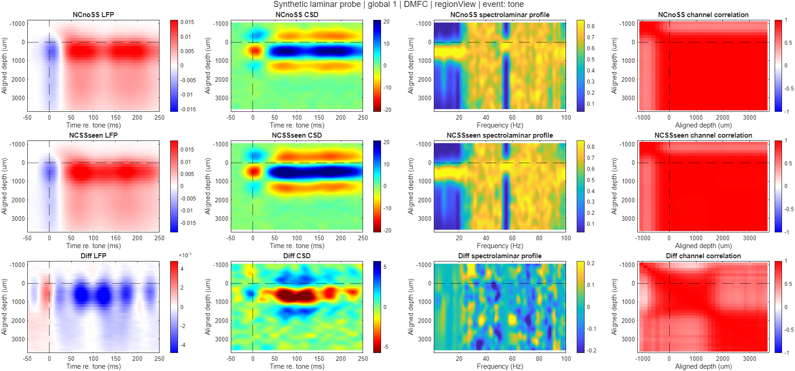

# ACC/DMFC Laminar Analysis Pipeline

MATLAB tools for event-aligned LFP, current-source density (CSD), spectrolaminar
PSD, physical-depth alignment, session diagnostics, group plots, and trial/patch
statistics. Main processing and statistics are distributed together because they
share the +laminar helpers.

## Quick Start: One Synthetic Probe

Requires MATLAB with **Signal Processing Toolbox** and **Statistics and Machine
Learning Toolbox**. The publishing example is validated on R2025b; older releases
are not certified. No experimental recording or external dataset is required.

From the downloaded repository folder:

~~~matlab
addpath(pwd)
addpath(fullfile(pwd,'examples','synthetic_probe'))
report = run_example;
~~~

The example reads one bundled raw MAT file containing a generated 32-channel,
150-um DMFC-style probe, 32 trials, two conditions, event times, trial regressors,
and alignment metadata. It produces full-probe and aligned diagnostics, aligned
CSD panels, and a single-session mean summary under outputs/synthetic_demo/.
It also compares numerical maps against the bundled reference output.

**This is simulated data, not an experimental result.** Its analytic signals
illustrate layered evoked responses and depth-dependent spectral bands. No real
samples, real session names, or fitted subject parameters are included. See
[example details](examples/synthetic_probe/README.md) for generation and limitations.

## Grid Views

Grid panels can show cached per-probe channel correlations, regional or full-32
ACC signals with sulcus/alignment markers, and an optional descriptive cell
correlation mean. Select one site or an inclusive rectangle using cfg.grid.filter.
See the grid-coordinate section in [USER_GUIDE.md](USER_GUIDE.md) for new-run
settings and cached-only revision examples. No signal recomputation is needed.

## Documentation

| Document | Purpose |
| --- | --- |
| [Example](examples/synthetic_probe/README.md) | Input schema, generated output, reproduction |
| [User guide](USER_GUIDE.md) | Main pipeline options, raw/precomputed modes, ACC/DMFC, revisions, grids |
| [Main technical guide](PIPELINE_TECHNICAL_GUIDE.md) | Computation, data contracts, code relationships |
| [Statistics user guide](statistics/README.md) | Hypothesis branches, ANOVA and plot-only revision examples |
| [Statistics technical guide](statistics/STATISTICS_TECHNICAL_GUIDE.md) | Algorithms, schemas, interpretation and current limits |
| [Validation](VALIDATION.md) | Test commands and release verification status |

Advanced example scripts contain clearly marked path/to/... placeholders for
user-supplied data. Edit those before running the advanced examples. The bundled
example uses repository-relative paths and writes only ignored generated outputs.

## Tests

~~~matlab
addpath(pwd)
addpath('tests')
addpath('statistics')
addpath(fullfile('statistics','tests'))
test_bundled_example
test_pipeline
test_statistics_module
~~~

The full suites generate temporary synthetic inputs/figures and can take several
minutes. Expected missing-metadata warnings are part of failure-path tests.
Numerical tests compare arrays, not platform-dependent PNG bytes.

## Repository Contents and Data Policy

Only source, tests, documentation, one synthetic input MAT, one compact numerical
reference MAT and four corresponding PNGs are tracked. Generated output folders,
FIGs, epoch caches, local recordings, spreadsheets, autosaves and archives are
ignored. No original local output directory is included.

License selection is **undecided**. No open-source license is granted by this
repository at this time. See [provenance and licensing notes](PROVENANCE.md).

## Statistics and Revisions

After run_example:

~~~matlab
addpath(fullfile(pwd,'statistics'))
example_statistics_run
~~~

This exercises trial-wise LFP/CSD/PSD tests and patch ANOVA on synthetic trials.
There is only one probe: direct-grand statistical inference needs at least two
independent probes, so its significance maps will be empty. Do not duplicate the
single probe to create artificial group sample size. Multi-probe behavior is
covered by the synthetic tests.

Redraw results without repeating signal calculations or tests:

~~~matlab
folder = fullfile(pwd,'outputs','synthetic_demo','statistics');
options = struct('figureSets',{{'probeSpecific','overlay'}}, ...
    'branches',{{'difference'}},'metrics',{{'CSD'}});
revise_statistical_visualizations(folder,'CSD_review',options);
~~~

For main-pipeline plots, use main_revise_visualizations.m. For changed alignment,
use main_revise_alignment.m. Extension/exclusion examples require your own
additional/multi-probe data; only one example input is distributed.

## Grid Display Controls

For equal visual grid cells with minimal padding, choose spacingMode='uniform'.
cellSize=[] auto-fits the largest session group and label; [width height] is a
manual override. Coordinate values remain labels, not distance ratios. See
GRID_PRESENTATION.md for cellPadding/cellLabelHeight and compatibility details.

Optional spatial cell dividers: plotOverrides.grid.showGridLines=true, with
gridLineColor, gridLineWidth and gridLineStyle. Independent of empty text, ticks
and joined-session separators; see GRID_PRESENTATION.md for interactions.

Full-lattice grid display: latticeSpacing=[dx dy] defines coordinate-unit steps;
coordinateScale defines pixels per unit. showEmptyCells controls existing empty
text only, without removing lattice geometry. See GRID_PRESENTATION.md.

For edge-to-edge session strips within each grid site, set
plotOverrides.grid.sessionLayout='joined' and individualCellColumns=[] (automatic
maximum) or a manual integer. plotOverrides.timeWindow applies to each LFP/CSD
panel. See GRID_PRESENTATION.md for separators, scaling and colorbar behavior.

## Coordinate Layouts, Detail Pages and PDF Export

Grid strict/coordinate mode now uses actual coordinate values on BOTH axes and
a common pixel scale: a 1-unit gap is twice a 0.5-unit gap. compressed mode
preserves shared rows/columns while reducing skipped intervals. Session slots
retain the same pixel size in sparse and crowded cells; occupied boxes adapt
to session count. Optional detailPages exports overlapping cached spatial
windows. plotOverrides.exportFormats={'fig','png','pdf'} adds vector PDF text/
lines alongside the usual outputs, also for statistical/ANOVA revisions.
See GRID_PRESENTATION.md for full settings, tradeoffs and examples.

Use plotOverrides.grid.swapXY=true in cached revisions (or cfg.grid.swapXY=true
in new runs) to exchange horizontal/vertical grid coordinates. Filters still
use original coordinates. See GRID_PRESENTATION.md for output metadata details.

Grid overview decoration/layout controls (hidden colorbars, legends/ticks,
uniform enlarged panels, and empty-cell suppression with spatial gaps) are
documented in [GRID_PRESENTATION.md](GRID_PRESENTATION.md).

## Reference-Line Styles

Cached plot revisions accept plotOverrides.indicators.alignment, .sulcus and
.exclusion with color (RGB), lineWidth, lineStyle, visible and optional views.
Unsupported markers warn and are not fabricated; regional/statistical views
have no common sulcus. See [Reference Indicator Styling](INDICATOR_STYLING.md) for
main/statistical examples, view selectors, warning behavior and implementation.
